# 중간 보고서 — 폴리마켓: Django 기반 동네 중고거래 웹 서비스 (당근마켓 클론코딩)

| 항목 | 내용 |
|---|---|
| 과목 담당 | 고진형 교수님 |
| 제출자 | 학번: ____ / 이름: ____ |
| 제출일 | [작성 예정] |
| 저장소 | https://github.com/oceanstarlight/Django_danggeun_market |
| 분석 기준 | git HEAD `ee841ef` (allow host render) |

---

## 목차

1. [프로젝트 개요](#1-프로젝트-개요)
2. [개발 환경 및 기술 스택](#2-개발-환경-및-기술-스택)
3. [시스템 구조](#3-시스템-구조)
4. [데이터 모델](#4-데이터-모델)
5. [기능 구현](#5-기능-구현)
6. [화면 구성](#6-화면-구성)
7. [배포](#7-배포)
8. [한계점 및 기말 개선 계획](#8-한계점-및-기말-개선-계획)
9. [결론](#9-결론)

> 본 보고서는 git HEAD 시점의 소스 코드만을 근거로 작성했다. `staticfiles/`는 `collectstatic` 결과물이므로 분석 대상에서 제외했다. 본문의 파일 경로와 행 번호는 모두 HEAD 기준이다.

---

## 1. 프로젝트 개요

### 1.1 목적과 콘셉트

**폴리마켓(Poly Market)**은 Django로 구현한 **동네 중고거래 웹 서비스**로, 국내 중고거래 플랫폼인 당근마켓을 클론 코딩한 프로젝트이다(`README.md` 1~3행: "Django로 만드는 동네 중고거래 플랫폼 — 당근마켓 클론 코딩 프로젝트"). 목표는 중고거래의 기본 흐름인 **회원가입 → 상품 등록 → 찜 → 판매자와의 실시간 채팅**을 하나의 웹 애플리케이션 안에서 구현하는 것이다.

- **서비스 이름**: 커밋 `542643f`(2026-10-29, "폴리마켓 UI 디자인 적용")에서 "폴리 / 폴리마켓"으로 변경되었다. 화면에서는 `templates/market/main.html` 12행과 `templates/market/header.html` 12행(로고 텍스트 "폴리")에서 이 이름을 사용한다(9행의 `alt="폴리마켓"`은 HTML 주석 안의 예시라 화면에 출력되지 않는다).
- **프로젝트 구성**: 설정 패키지 `config/`와 단일 앱 `market/`으로 이루어져 있다(`config/settings.py` 44~55행 `INSTALLED_APPS`, `config/urls.py`에서 `market.urls` include).

### 1.2 구현 범위 요약

| 영역 | 구현 내용 |
|---|---|
| 회원 | 회원가입(아이디·이름·생년월일·휴대폰번호, 중복 검사), 로그인, 로그아웃 |
| 상품 | 목록·검색, 등록, 상세(조회수 증가), 수정, 삭제(작성자 권한 검사), 이미지 업로드(Supabase Storage) |
| 찜 | 상세 화면에서 찜/찜 취소 토글 |
| 채팅 | 상품별 1:1 채팅방 생성, 내 채팅 목록, WebSocket 기반 실시간 메시지 송수신 |
| 메인 | 조회수 상위 5개 상품("지금 뜨는 중고거래") |
| 운영 | Django Admin 모델 등록, Render 배포, 헬스 체크(`/state/`) |

### 1.3 개발 일정 (Git 이력)

저장소에는 커밋 17개가 있으며, 두 명의 작성자가 GitHub Pull Request(#1, #2)를 통해 협업했다. 주요 이력은 다음과 같다.

| 날짜 | 커밋 | 주요 변경 내용 |
|---|---|---|
| 2026-09-10 | `95b2901`, `92539c7`, `75db54b`, `1f6772b` | 저장소 생성, Django 프로젝트(`config`)·앱(`market`) 생성, 가상환경 폴더 추적 제거 |
| 2026-09-17 | `dbbe805` | DB를 Supabase PostgreSQL로 전환하고 접속 정보를 환경 변수로 분리 |
| 2026-10-08 | `567f2b5`, `9f8bbb8` | 회원가입·로그인·로그아웃 구현, `0001_initial` 마이그레이션, `PROGRESS.md` 추가 |
| 2026-10-22 | `e4919a2` | 상품 CRUD·찜·채팅 모델과 `0002` 마이그레이션, Channels 구성(`asgi.py`, `consumers.py`, `routing.py`), Supabase Storage 업로드(`storage.py`), 상품·채팅 템플릿 추가(파일 18개, +1,618줄) |
| 2026-10-29 | `542643f` → `830f825` (PR #1) | 공용 `style.css`와 공통 `header.html` 도입, 템플릿 리디자인, 서비스명 변경 |
| 2026-10-29 | `595c2db` → `003d344` (PR #2) | README 로컬 환경 세팅(Linux/Windows) 추가 및 변경 이력 최신화 |
| 2026-11-05 | `4ed4f7c` | Render 배포 설정: `SECRET_KEY` 환경 변수화, `ALLOWED_HOSTS` 정리, WhiteNoise·`STATIC_ROOT`, `/state/` 추가, `build.sh`·`requirements.txt` 추가, `staticfiles/` 커밋 |
| 2026-11-05 | `b204548`, `c22e13e`, `113fd8f`, `ee841ef` | `build.sh` 루트 이동, `requirements.txt`에 gunicorn·uvicorn·whitenoise·click 추가(이후 `requirments.txt`와 내용 동일), Render 도메인 허용 및 `DEBUG = False` |

개발은 **9월 환경 구축(프로젝트 생성·Supabase 연동) → 10월 초·중순 기능 구현(인증, 상품, 찜, 실시간 채팅) → 10월 말 UI·문서 정비 → 11월 초 Render 배포**의 네 단계로 진행되었다. 커밋 날짜(9/10, 9/17, 10/8, 10/22, 10/29, 11/5)가 모두 목요일로, 대략 주 단위로 작업이 이어졌다.

---

## 2. 개발 환경 및 기술 스택

### 2.1 기술 스택

| 구분 | 기술 | 근거 파일 |
|---|---|---|
| 언어 | Python 3 (README 안내: 개발 환경 3.14, 최소 3.10 이상) | `README.md` "로컬 환경 세팅" |
| 웹 프레임워크 | Django 5.2 (5.2.17로 `startproject`, 현재 5.2.19 설치) | `config/settings.py` 4행, `requirements.txt` |
| 실시간 통신 | Django Channels + Daphne(ASGI 서버) + WebSocket | `config/asgi.py`, `market/routing.py`, `config/settings.py` 45행 |
| 데이터베이스 | PostgreSQL (Supabase 호스팅) | `config/settings.py` 93~106행 |
| 파일 저장소 | Supabase Storage (`product-images` 버킷) | `market/storage.py` |
| 정적 파일 | WhiteNoise | `config/settings.py` 65행, 153~154행 |
| 프런트엔드 | Django Template + 공용 CSS 1개 + Vanilla JS | `templates/market/*.html`, `market/static/market/css/style.css` |
| 배포 | Render (빌드 스크립트 `build.sh`) | `build.sh`, `config/settings.py` 30~41행 |
| 지역화 | `LANGUAGE_CODE = 'ko-kr'`, `TIME_ZONE = 'Asia/Seoul'`, `USE_TZ = True` | `config/settings.py` 141~147행 |

### 2.2 주요 패키지 (`requirements.txt`)

`requirements.txt`는 UTF-16 LE(BOM 포함)·CRLF 줄바꿈으로 저장되어 있어 `iconv -f UTF-16 -t UTF-8`로 변환해 확인했다.

| 분류 | 패키지 (버전) |
|---|---|
| 웹 프레임워크 | Django 5.2.19, asgiref 3.13.0, sqlparse 0.6.1 |
| 실시간/ASGI | channels 4.3.2, daphne 4.2.3, Twisted 26.10.0, autobahn 26.11.1, websockets 15.0.1, uvicorn 0.54.0 |
| WSGI/프로세스 | gunicorn 26.2.0 |
| DB 드라이버 | psycopg 3.3.8, psycopg2 2.9.13 |
| Supabase SDK | supabase 2.34.0 (storage3·postgrest·realtime·supabase-auth·supabase-functions 각 2.34.0), httpx 0.28.1 |
| 정적 파일 / 환경 변수 | whitenoise 6.12.0, python-dotenv 1.2.4, dotenv 0.9.9 |
| 기타 | pydantic 2.14.2, PyJWT 2.15.1, cryptography 50.0.2, tzdata 2026.6 등 |

이 파일과 관련해 확인된 사항은 다음과 같다(정리 과제는 8장에서 다룬다).

- 철자가 틀린 `requirments.txt`가 함께 있으며, `cmp` 비교 결과 내용이 완전히 같다. `build.sh`는 `requirements.txt`만 사용한다.
- `market/forms.py` 106행의 `ProductForm`이 `forms.ImageField`를 사용하지만 **Pillow는 목록에 없다**. `README.md`의 수동 설치 명령에는 `pillow`가 포함되어 있다.
- `README.md`의 "3. 패키지 설치"에는 "`requirements.txt` 는 없으므로 직접 설치합니다"라고 적혀 있다. README는 10월 29일에 수정되었고 `requirements.txt`는 11월 5일 `4ed4f7c`에서 추가되었으므로 현재 상태와 맞지 않는다.

### 2.3 환경 변수 (`.env`)

`config/settings.py` 19행의 `load_dotenv(BASE_DIR / ".env")`가 프로젝트 루트의 `.env`를 읽는다. `.env`는 `.gitignore`에 등록되어 저장소에서 제외된다.

| 변수 | 용도 | 사용 위치 |
|---|---|---|
| `SECRET_KEY` | Django 비밀 키 | `config/settings.py` 25행 |
| `DB_NAME`, `DB_USER`, `DB_PASSWORD`, `DB_HOST`, `DB_PORT` | Supabase PostgreSQL 접속 정보 | `config/settings.py` 96~100행 |
| `SUPABASE_URL`, `SUPABASE_SERVICE_ROLE_KEY` | Supabase Storage 클라이언트 생성 | `market/storage.py` 7~8행 |
| `RENDER_EXTERNAL_HOSTNAME` | Render가 주입하는 호스트명(있으면 `ALLOWED_HOSTS`에 추가) | `config/settings.py` 36~41행 |

`SECRET_KEY`는 처음에는 하드코딩된 `django-insecure-...` 값이었으나 커밋 `4ed4f7c`에서 환경 변수로 분리되었다. 다만 `README.md`의 `.env` 예시에는 DB 5개와 Supabase 2개 변수만 있고 `SECRET_KEY`는 빠져 있다.

---

## 3. 시스템 구조

### 3.1 디렉터리 구조

```
Django_danggeun_market/
├── README.md, PROGRESS.md, manage.py
├── build.sh                    # Render 빌드 스크립트
├── requirements.txt            # 의존성 목록 (UTF-16 LE, CRLF)
├── requirments.txt             # 위 파일과 동일한 철자 오류 사본
├── config/                     # 프로젝트 설정 패키지
│   ├── settings.py             # DB, CHANNEL_LAYERS, ASGI_APPLICATION, 정적 파일
│   ├── urls.py                 # admin/ + market.urls
│   ├── asgi.py                 # ProtocolTypeRouter: http / websocket 분기
│   └── wsgi.py
├── market/                     # 유일한 애플리케이션
│   ├── models.py               # Profile, Product, Wishlist, ChatRoom, ChatMessage
│   ├── forms.py                # SignUpForm, ProductForm
│   ├── views.py                # 함수 기반 뷰 14개 (491행)
│   ├── urls.py                 # HTTP URL 패턴 14개
│   ├── consumers.py            # ChatConsumer (JsonWebsocketConsumer)
│   ├── routing.py              # websocket_urlpatterns
│   ├── storage.py              # Supabase Storage 이미지 업로드
│   ├── admin.py, apps.py, tests.py
│   ├── migrations/0001_initial.py, 0002_chatroom_chatmessage_...py
│   └── static/market/css/style.css
├── templates/market/           # 템플릿 10개 (header.html + 페이지 9개)
└── staticfiles/                # collectstatic 결과물 (127개 파일 커밋)
```

### 3.2 전체 아키텍처

```
 ┌───────────────────────────── 사용자 브라우저 ─────────────────────────────┐
 │  일반 페이지: HTTP(S) GET/POST (폼 + CSRF)                                 │
 │  채팅방: new WebSocket(`${ws|wss}://host/ws/chat/{id}/`)                   │
 └──────────────┬──────────────────────────────────────┬────────────────────┘
                │ HTTPS                                │ WSS
                ▼                                      ▼
 ┌──────────── Render 웹 서비스 (django-danggeun-market-vwl5.onrender.com) ──┐
 │  ASGI 서버 (Daphne) ── ASGI_APPLICATION = "config.asgi.application"       │
 │                    ProtocolTypeRouter (config/asgi.py)                   │
 │         "http" ▼                                  ▼ "websocket"          │
 │   django_asgi_app                      AllowedHostsOriginValidator       │
 │   → MIDDLEWARE (… WhiteNoise)          → AuthMiddlewareStack             │
 │   → config/urls.py → market/urls.py    → URLRouter: ws/chat/<room_id>/   │
 │   → market/views.py → templates        → ChatConsumer                    │
 │                                          ↕ group_add / group_send        │
 │                                        InMemoryChannelLayer              │
 │                                        (그룹 "chat-{room_id}", 단일 프로세스)│
 └──────────────┬──────────────────────────────────────┬────────────────────┘
                │ Django ORM (sslmode=require)         │ supabase-py (storage.py)
                ▼                                      ▼
 ┌─ Supabase PostgreSQL ─────────────┐   ┌─ Supabase Storage ──────────────────┐
 │ auth_user, Profile, Product,      │   │ 버킷 "product-images"                │
 │ Wishlist, ChatRoom, ChatMessage,  │   │ products/{user_id}/{uuid}.{ext}      │
 │ 세션 등                            │   │ 공개 URL → Product.image_url에 저장   │
 └───────────────────────────────────┘   └──────────────────────────────────────┘
          브라우저는 로 Storage 공개 URL에서 이미지를 직접 받는다.
```

그림의 Daphne는 `INSTALLED_APPS` 첫 항목 `"daphne"`(`config/settings.py` 45행), `ASGI_APPLICATION` 설정(160행), `requirements.txt`의 `daphne==4.2.3`을 근거로 했다. Render의 실제 Start Command는 저장소에 없으며, `requirements.txt`에는 `gunicorn`과 `uvicorn`도 함께 들어 있다.

### 3.3 HTTP 요청 흐름

```
브라우저 → Daphne → ProtocolTypeRouter["http"] → django_asgi_app
  → MIDDLEWARE (Security → Session → Common → Csrf → Auth → Messages → XFrame → WhiteNoise)
  → ROOT_URLCONF = config.urls ("admin/" | "" → market.urls)
  → market/views.py 함수 뷰 (ORM 조회·저장, 필요 시 Supabase 업로드)
  → render(templates/market/*.html) 또는 redirect()
```

- **인증**: `django.contrib.auth`의 `authenticate`/`login`/`logout`을 사용하고, 보호가 필요한 뷰 7개에 `@login_required`를 붙였다.
- **권한**: `product_update`·`product_delete`는 작성자가 아니면, `chat_room`은 판매자·구매자가 아니면 `PermissionDenied`(HTTP 403)를 발생시킨다.
- **렌더링**: 모든 화면은 서버 렌더링 Django Template이며, JavaScript는 `chat_room.html`의 WebSocket 클라이언트에만 쓰인다.

### 3.4 WebSocket 처리 구조 (`config/asgi.py`, `market/routing.py`)

```python
# config/asgi.py (요약)
os.environ.setdefault('DJANGO_SETTINGS_MODULE', 'config.settings')
application = get_asgi_application()          # (A) 아래에서 덮어씀
django_asgi_app = (get_asgi_application())    # (B) HTTP 처리용
from market.routing import websocket_urlpatterns
application = ProtocolTypeRouter({
    "http": django_asgi_app,
    "websocket": AllowedHostsOriginValidator(
        AuthMiddlewareStack(URLRouter(websocket_urlpatterns))),
})

# market/routing.py
websocket_urlpatterns = [path("ws/chat/<int:room_id>/", ChatConsumer.as_asgi())]
```

- `get_asgi_application()`을 Channels·`market.routing` import보다 먼저 호출하므로, 앱 레지스트리가 초기화된 뒤 `market.consumers` → `market.models`가 import된다.
- WebSocket은 바깥부터 **Origin 검증(`ALLOWED_HOSTS` 기준) → 세션 기반 인증(`scope["user"]`) → URL 라우팅** 순으로 처리된다. HTTP의 `AuthenticationMiddleware`와 WebSocket의 `AuthMiddlewareStack`이 같은 Django 세션을 읽으므로 로그인 상태가 공유된다.
- `get_asgi_application()`이 (A)와 (B)에서 두 번 호출되지만, (A)는 `ProtocolTypeRouter`로 덮어써져 최종 진입점에는 영향이 없다.
- 채널 레이어는 `channels.layers.InMemoryChannelLayer`이다(`config/settings.py` 108~117행). Redis 같은 외부 브로커 없이 단일 프로세스 메모리 안에서만 그룹 메시지를 전달한다.

### 3.5 URL 구성

`config/urls.py`는 `admin/`과 `path('', include('market.urls'))` 두 패턴만 가진다. `market/urls.py`의 14개 패턴은 다음과 같다. 저장소에는 `@require_POST` 같은 메서드 제한 데코레이터가 없으며, 메서드별 동작은 각 뷰의 `if request.method == "POST":` 분기로 나뉜다.

| URL | 뷰 (`market/views.py`) | 로그인 | 동작 |
|---|---|:---:|---|
| `/` | `main` (33행) | X | 조회수 상위 5개 상품 렌더링 |
| `/state/` | `state` (490행) | X | `text/plain`으로 `"server OK"` 반환(헬스 체크) |
| `/signup/` | `signup` (51행) | X | GET: 빈 폼 / POST: 가입 → 자동 로그인 → 메인 |
| `/login/` | `login_view` (94행) | X | POST: `authenticate` 성공 시 로그인, 실패 시 `messages.error` |
| `/logout/` | `logout_view` (145행) | X | POST일 때만 `logout()`, 항상 메인으로 이동 |
| `/products/` | `product_list` (156행) | X | 전체 상품, `?q=` 검색 |
| `/products/new/` | `product_create` (185행) | O | 상품 등록(이미지 업로드 포함) |
| `/products/<id>/` | `product_detail` (236행) | X | 조회수 증가, 찜 여부 계산 |
| `/products/<id>/edit/` | `product_update` (275행) | O + 작성자 | 상품 수정 |
| `/products/<id>/delete/` | `product_delete` (336행) | O + 작성자 | GET: 확인 화면 / POST: 삭제 |
| `/products/<id>/wishlist/` | `wishlist_toggle` (364행) | O | POST: 찜 토글 |
| `/products/<id>/chat/` | `chat_start` (398행) | O | 채팅방 조회·생성 후 이동(템플릿에서 `<a href>` GET 링크로 호출) |
| `/chats/` | `chat_list` (430행) | O | 내 채팅방 목록 |
| `/chats/<room_id>/` | `chat_room` (457행) | O + 참여자 | 기존 메시지 렌더링 |

이 밖에 `/admin/`(모델 5개 등록)과 WebSocket 경로 `ws/chat/<int:room_id>/`(참여자만 연결 허용)가 있다.

---

## 4. 데이터 모델

도메인 모델은 모두 `market/models.py`에 있다. 사용자 계정은 커스텀 User 없이 Django 기본 `django.contrib.auth.models.User`를 쓰고, 추가 회원 정보는 1:1로 연결된 `Profile`에 저장한다. `DEFAULT_AUTO_FIELD = 'django.db.models.BigAutoField'`(`config/settings.py` 159행)이므로 모든 모델의 `id`는 `BigAutoField`이다.

### 4.1 모델별 필드

**`Profile`** (회원 부가정보, `market/models.py` 5~24행)

| 필드 | 타입 | 제약 / 옵션 |
|---|---|---|
| `user` | OneToOneField → `User` | `CASCADE`, `related_name="profile"` |
| `birth_date` | DateField | `verbose_name="생년월일"` |
| `phone` | CharField(20) | **`unique=True`**, `verbose_name="휴대폰번호"` |

**`Product`** (중고 상품 게시글, 26~79행)

| 필드 | 타입 | 제약 / 옵션 |
|---|---|---|
| `seller` | ForeignKey → `User` | `CASCADE`, `related_name="products"` |
| `title` / `content` | CharField(100) / TextField | 필수 |
| `image_url` | URLField | `blank=True`, `null=True` |
| `region` | CharField(100) | 필수 |
| `price` | PositiveIntegerField | 0 이상 정수 |
| `negotiable` | BooleanField | `default=False` (가격 제안 가능 여부) |
| `view_count` | PositiveIntegerField | `default=0` |
| `created_at` / `updated_at` | DateTimeField | `auto_now_add` / `auto_now` |

`Meta.ordering = ["-created_at"]`으로 기본 정렬은 최신순이다. DB 컬럼이 아닌 계산 속성 두 개를 제공한다.

```python
@property
def wish_count(self):
    return self.wishlists.count()   # market/models.py 73~75행

@property
def chat_count(self):
    return self.chat_rooms.count()  # market/models.py 77~79행
```

`ChatRoom`이 (상품, 구매자) 쌍마다 유일하므로 `chat_count`는 "채팅을 건 구매자 수"와 같으며, 상세 화면에서 "채팅 N명"으로 표시된다(`product_detail.html` 86행).

**`Wishlist`** (찜, 82~109행): `user`(FK → `User`, `related_name="wishlists"`), `product`(FK → `Product`, `related_name="wishlists"`), `created_at`. `UniqueConstraint(fields=["user", "product"], name="unique_user_product_wishlist")`로 중복 찜을 막는다. 사실상 `User`–`Product` N:M 관계의 중간 테이블이다.

**`ChatRoom`** (1:1 거래 채팅방, 112~145행): `product`(FK, `related_name="chat_rooms"`), `seller`(FK → `User`, `related_name="selling_chat_rooms"`), `buyer`(FK → `User`, `related_name="buying_chat_rooms"`), `created_at`. `UniqueConstraint(fields=["product", "buyer"], name="unique_product_buyer_chatroom")`로 구매자·상품당 방을 하나로 제한한다. `User`를 참조하는 FK가 두 개이므로 `related_name`을 서로 다르게 지정했다. `seller`는 `product.seller`를 중복 저장한 비정규화 컬럼으로, 채팅 목록 조회의 `Q(seller=...)` 조건에 직접 쓰인다.

**`ChatMessage`** (채팅 메시지, 148~172행): `room`(FK → `ChatRoom`, `related_name="messages"`), `sender`(FK → `User`, `related_name="chat_messages"`), `content`(TextField), `created_at`. `Meta.ordering = ["created_at"]`으로 시간순 정렬된다.

### 4.2 관계 요약 (ERD)

```
                         ┌──────────────┐
       ┌──── 1:1 ────────│  auth.User   │──────── 1:N (chat_messages) ────┐
       ▼                 └──────────────┘                                 ▼
 ┌───────────┐       1:N │ products   │ wishlists   │ selling/buying   ┌─────────────┐
 │  Profile  │           ▼            ▼             ▼ _chat_rooms      │ ChatMessage │
 │ phone UQ  │     ┌───────────┐  ┌────────────┐  ┌────────────────┐   │ room FK     │
 └───────────┘     │  Product  │─▶│  Wishlist  │  │    ChatRoom    │──▶│ sender FK   │
                   │ seller FK │  │ UQ(user,   │  │ UQ(product,    │1:N└─────────────┘
                   └───────────┘  │   product) │  │    buyer)      │
                        │   1:N   └────────────┘  └────────────────┘
                        └──────────── 1:N (chat_rooms) ──────▲
```

| 자식.필드 | → 부모 | 카디널리티 | 역참조 |
|---|---|---|---|
| `Profile.user` | `User` | 1 : 1 | `user.profile` |
| `Product.seller` | `User` | 1 : N | `user.products` |
| `Wishlist.user` / `Wishlist.product` | `User` / `Product` | 1 : N | `user.wishlists` / `product.wishlists` |
| `ChatRoom.product` | `Product` | 1 : N | `product.chat_rooms` |
| `ChatRoom.seller` / `ChatRoom.buyer` | `User` | 1 : N | `user.selling_chat_rooms` / `user.buying_chat_rooms` |
| `ChatMessage.room` / `ChatMessage.sender` | `ChatRoom` / `User` | 1 : N | `room.messages` / `user.chat_messages` |

모든 FK와 OneToOne이 `on_delete=CASCADE`이다. 사용자를 삭제하면 프로필·상품·찜·채팅방·메시지가 함께 삭제되고, 상품을 삭제하면 그 상품의 찜·채팅방·메시지가 연쇄 삭제된다.

| 유일성 제약 | 의미 |
|---|---|
| `Profile.phone` (`unique=True`) | 휴대폰번호 중복 가입 방지 |
| `Profile.user` (OneToOne) | 사용자당 프로필 1개 |
| `unique_user_product_wishlist` | 같은 상품 중복 찜 방지 |
| `unique_product_buyer_chatroom` | 구매자·상품당 채팅방 1개 |

### 4.3 마이그레이션과 관리자 등록

| 파일 | 생성(파일 헤더) | 내용 |
|---|---|---|
| `0001_initial.py` | Django 5.2.17, 2026-10-08 | `Profile` 생성 |
| `0002_chatroom_chatmessage_product_chatroom_product_and_more.py` | Django 5.2.17, 2026-10-22 | `ChatRoom`, `ChatMessage`, `Product`, `Wishlist` 생성, `ChatRoom.product` FK 추가, 두 `UniqueConstraint` 추가 |

두 마이그레이션은 `settings.AUTH_USER_MODEL`에 의존하며, `0002`의 필드·제약은 현재 `models.py`와 일치한다.

`market/admin.py`는 `ProfileAdmin`(`list_display`, `search_fields`)과 `ProductAdmin`(`list_display`, `search_fields`, `list_filter = ["negotiable", "region", "created_at"]`)을 데코레이터로 등록하고, `Wishlist`·`ChatRoom`·`ChatMessage`는 기본 `admin.site.register()`로 등록한다.

---

## 5. 기능 구현

> 아래 코드 발췌는 원본(인자를 한 줄에 하나씩 쓰는 스타일)에서 줄바꿈을 줄이고, 일부는 중간 변수를 합치거나 핵심이 아닌 줄을 `...`로 생략했다.

### 5.1 회원가입

`SignUpForm`(`market/forms.py`)은 Django `UserCreationForm`을 상속하고 `name`, `birth_date`(`type="date"` 위젯), `phone` 필드를 추가했다. 중복 검사는 `clean_username()`, `clean_phone()`에서 `exists()` 조회로 수행하며(44~75행), DB 수준의 `Profile.phone` `unique=True`와 함께 이중으로 중복을 막는다. `save()`는 다음과 같이 오버라이드했다(78~102행).

```python
def save(self, commit=True):
    user = super().save(commit=False)
    user.first_name = self.cleaned_data["name"]
    if commit:
        user.save()
        Profile.objects.create(user=user,
            birth_date=self.cleaned_data["birth_date"], phone=self.cleaned_data["phone"])
    return user
```

`signup` 뷰는 이미 로그인한 사용자를 메인으로 보내고, 폼이 유효하면 `form.save()` 후 `login(request, user)`로 바로 로그인시킨다. `signup.html`은 필드별 `form.<필드>.errors`를 `.form-error`로 출력해 중복 오류를 해당 입력란 아래에 표시한다.

### 5.2 로그인 / 로그아웃

`login_view`(94~142행)는 폼 클래스 없이 `request.POST`의 아이디·비밀번호로 `authenticate()`를 호출한다. 실패하면 `messages.error(request, "아이디 또는 비밀번호가 올바르지 않습니다.")`를 남기고, `login.html` 38~44행이 이를 `.alert`로 출력한다. `logout_view`는 POST일 때만 `logout()`을 호출하며, 헤더(`header.html` 54~65행)와 메인 사이드의 로그아웃 버튼도 ``을 포함한 POST 폼이다.

### 5.3 상품 목록과 검색 (Q 객체)

```python
products = Product.objects.select_related("seller").all()
query = request.GET.get("q", "").strip()
if query:
    products = products.filter(
        Q(title__icontains=query) | Q(content__icontains=query) | Q(region__icontains=query))
```

`product_list`(156~181행)는 제목·본문·지역 중 하나라도 검색어를 포함하면 결과에 넣는다. `select_related("seller")`로 판매자를 JOIN해 가져오고, 정렬은 `Meta.ordering`에 따라 최신순이다. 검색창은 모든 페이지에 포함되는 `header.html`의 GET 폼(`name="q"`)이며, 목록 사이드의 인기 검색어 칩은 `?q=아이폰` 같은 링크로 같은 검색을 실행한다.

### 5.4 상품 등록·수정·삭제와 작성자 권한

`product_create`는 `ProductForm(request.POST, request.FILES)`로 업로드 파일까지 받고, `form.save(commit=False)` 후 판매자를 서버에서 지정한다.

```python
product = form.save(commit=False)
product.seller = request.user
image = form.cleaned_data.get("image")
if image:
    product.image_url = upload_product_image(image, request.user.id)
product.save()
```

`ProductForm`(104~129행)은 `Product`의 `ModelForm`이며, 모델에 없는 `image = forms.ImageField(required=False)`를 따로 선언해 업로드 결과 URL만 `image_url`에 저장한다. 등록·수정은 `product_form.html`을 공유하고 `page_title`로 제목("중고상품 등록"/"상품 수정")을 구분한다.

`product_update`와 `product_delete`는 `@login_required`로 로그인을 확인한 뒤 `if product.seller != request.user: raise PermissionDenied`로 작성자를 검사한다(282~283행, 343~344행). 수정 시 새 이미지를 올린 경우에만 `image_url`을 바꾸고, 삭제는 GET에서 확인 화면을, POST에서만 `product.delete()`를 실행한다. 상세 템플릿은 작성자에게만 수정·삭제 버튼을 보여 주지만, URL 직접 접근은 뷰의 `PermissionDenied`가 차단한다.

### 5.5 이미지 업로드 (Supabase Storage)

```python
def upload_product_image(uploaded_file, user_id):
    extension = uploaded_file.name.split(".")[-1].lower()
    file_path = f"products/{user_id}/{uuid.uuid4().hex}.{extension}"
    supabase.storage.from_(BUCKET_NAME).upload(path=file_path, file=uploaded_file.read(),
        file_options={"content-type": uploaded_file.content_type, "upsert": "false"})
    return supabase.storage.from_(BUCKET_NAME).get_public_url(file_path)
```

`market/storage.py`는 모듈 로드 시 `create_client(SUPABASE_URL, SUPABASE_SERVICE_ROLE_KEY)`로 클라이언트를 생성한다. 파일명은 `uuid4().hex`로 충돌을 피하고, 경로를 사용자별로 나누며, `upsert: "false"`로 덮어쓰기를 막는다. 반환된 공개 URL은 `Product.image_url`에 저장되고, 템플릿은 ``로 출력하며 값이 없으면 "이미지 없음" 자리 표시자를 보여 준다. 즉 이미지 파일은 Django 서버가 아니라 외부 스토리지에 보관된다.

### 5.6 조회수 증가 (F 표현식)와 인기 상품

```python
Product.objects.filter(id=product.id).update(view_count=F("view_count") + 1)
product.refresh_from_db(fields=["view_count"])
```

`product_detail`(236~271행)은 `F()` 표현식으로 DB가 직접 `view_count = view_count + 1`을 실행하게 해 동시 요청 시 값이 덮어써지는 경쟁 조건을 피한다. `update()`는 메모리 객체를 바꾸지 않으므로 `refresh_from_db()`로 증가된 값만 다시 읽는다. 같은 뷰는 로그인 사용자에 한해 `Wishlist ... .exists()`로 `is_wished`를 계산해 찜 버튼 문구에 쓴다.

메인 뷰 `main`(33~48행)은 `Product.objects.select_related("seller").order_by("-view_count", "-created_at")[:5]`로 조회수 상위 5개를 뽑는다(`[:5]`는 SQL `LIMIT 5`). `main.html`은 `{{ forloop.counter }}`로 1~5위 순위를 붙이고, 상품이 없으면 "첫 판매글 작성하기" 버튼을 보여 준다.

### 5.7 찜 토글 (get_or_create)

```python
if product.seller == request.user:
    return redirect("product_detail", product_id=product.id)
if request.method == "POST":
    wishlist, created = Wishlist.objects.get_or_create(user=request.user, product=product)
    if not created:
        wishlist.delete()
return redirect("product_detail", product_id=product.id)
```

`wishlist_toggle`(364~394행)은 `get_or_create()`의 `created` 값으로 찜 등록과 취소를 하나의 버튼으로 처리하며, 판매자 본인의 상품은 찜할 수 없다. 상세 템플릿은 POST 폼과 ``으로 요청하고, `is_wished`에 따라 "♥ 찜 취소"/"♡ 찜하기"를 바꿔 표시한다.

### 5.8 채팅 시작과 채팅 목록

`chat_start`(398~426행)는 판매자 본인이면 상세로 되돌리고, 그 외에는 `ChatRoom.objects.get_or_create(product=product, buyer=request.user, defaults={"seller": product.seller})`로 방을 조회·생성한 뒤 채팅방으로 이동한다. `seller`는 조회 조건이 아니라 생성 시에만 쓰는 값이므로 `defaults`로 넘긴다.

`chat_list`(430~453행)는 `Q(seller=request.user) | Q(buyer=request.user)`로 내가 참여한 방을 모으고 `select_related("product", "seller", "buyer")`, `.order_by("-created_at")`(444행)을 적용한다. `chat_list.html`은 ``로 상대방과 역할 배지("구매자"/"판매자")를 결정한다.

`chat_room`(457~488행)은 참여자가 아니면 `PermissionDenied`를 발생시키고, `room.messages.select_related("sender").all()`로 기존 메시지를 불러온다. 컨텍스트 이름을 `chat_messages`로 정해 Django messages 프레임워크의 `messages` 변수와 충돌하지 않게 했다.

### 5.9 실시간 채팅: 서버 (`market/consumers.py`)

`ChatConsumer`는 동기식 `JsonWebsocketConsumer`를 상속한다.

| 단계 | 메서드 | 동작 |
|---|---|---|
| 연결 | `connect()` (20~62행) | 익명 사용자이면 `close()` → 방이 존재하고 사용자가 `seller` 또는 `buyer`인지 `Q` 조건으로 검사, 아니면 `close()` → 그룹 `chat-{room_id}`에 `group_add` → `accept()` |
| 수신 | `receive_json()` (83~121행) | 공백 제거 후 빈 메시지 무시 → `ChatMessage.objects.create(...)`로 DB 저장 → `group_send`로 그룹에 전달 |
| 전파 | `chat_message()` (124~133행) | 각 연결에 `send_json({message, username, created_at})` 전송 |
| 해제 | `disconnect()` (65~80행) | `room_group_name`이 있을 때만 `group_discard` |

```python
message = ChatMessage.objects.create(room=room, sender=self.user, content=message_text)
async_to_sync(self.channel_layer.group_send)(self.room_group_name, {
    "type": "chat.message",
    "message": message.content,
    "username": self.user.username,
    "created_at": timezone.localtime(message.created_at).strftime("%H:%M"),
})
```

채널 레이어 API는 비동기이므로 동기 컨슈머에서는 `async_to_sync`로 감싸 호출한다. 이벤트의 `"type": "chat.message"`는 Channels 규칙에 따라 `chat_message()` 메서드로 전달된다. 참여자 검사가 HTTP 뷰(`PermissionDenied`)와 WebSocket(`close()`) 양쪽에 있어, 채팅 페이지를 거치지 않고 소켓에 직접 접속해도 다른 사람의 방 메시지를 받을 수 없다.

### 5.10 실시간 채팅: 클라이언트 (`templates/market/chat_room.html`)

페이지를 처음 열면 서버 템플릿이 기존 메시지를 렌더링하고(66~86행), 이후 스크립트(113~237행)가 WebSocket에 연결한다.

```javascript
const myUsername = "{{ user.username|escapejs }}";
const protocol = window.location.protocol === "https:" ? "wss" : "ws";
const chatSocket = new WebSocket(`${protocol}://${window.location.host}/ws/chat/${roomId}/`);
chatSocket.onmessage = function(event) {
    const data = JSON.parse(event.data);
    wrapper.className = data.username === myUsername ? "chat-msg mine" : "chat-msg";
    bubble.textContent = data.message;   // innerHTML 대신 textContent
    ...
};
```

수신한 메시지는 `textContent`로 DOM에 넣으므로 HTML이나 스크립트가 문자 그대로 표시되어 XSS가 생기지 않는다. 전송은 입력값의 공백을 제거한 뒤 `chatSocket.send(JSON.stringify({"message": message}))`로 하며, [전송] 버튼과 Enter 키가 같은 `sendMessage()`를 호출한다. 보낸 사람 화면도 메시지를 즉시 그리지 않고 서버가 저장 후 되돌려 준 이벤트를 받아 그리므로, 두 참여자의 화면에는 DB에 저장된 같은 내용과 시간이 표시된다.

**전체 흐름**: 입력 → `chatSocket.send` → `receive_json` → `ChatMessage` 저장 → `group_send("chat-<room_id>")` → 각 소켓의 `chat_message` → `send_json` → 브라우저 `onmessage` → DOM 추가

---

## 6. 화면 구성

### 6.1 설계 개요

화면은 템플릿 10개(`templates/market/*.html`)와 공용 스타일시트 1개(`market/static/market/css/style.css`, 1,199줄)로 구성된다. 모든 페이지는 `<head>`에서 `` 하나만 불러오며, 페이지별 CSS나 인라인 `<style>`은 없다. 웹폰트는 Pretendard v1.3.9를 jsDelivr CDN에서 `@import`로 불러온다(13행). 모든 페이지에 `<meta name="viewport" content="width=device-width, initial-scale=1.0">`이 들어 있다.

### 6.2 공통 헤더 (`header.html`)

각 페이지는 `<div class="site">` 안에서 ``로 헤더를 불러온다. 헤더는 로고(메인 링크, 주황색 물방울 모양과 "폴리" 글자), 검색창(`name="q"` GET 폼, 검색어 유지), 상단 박스의 세 칸으로 이루어진다. 상단 박스는 로그인 상태이면 "{이름 또는 아이디}님"과 [채팅]·[로그아웃] 버튼을, 비로그인 상태이면 "내 근처에서 거래해보세요" 문구와 [로그인]·[회원가입] 버튼을 보여 준다. 헤더 컨테이너 `header.top`에 `display: contents`(`style.css` 150~152행)를 지정해 세 요소가 부모 `.site` 그리드의 1·2·3열에 직접 배치되도록 했다.

### 6.3 레이아웃과 반응형

```css
/* style.css 88~97행 (row-gap·align-items·padding 생략) */
.site {
    display: grid;
    grid-template-columns: var(--col-logo) minmax(0, var(--col-main)) var(--col-side);
    column-gap: var(--gap);
    max-width: calc(var(--col-logo) + var(--col-main) + var(--col-side) + var(--gap) * 2 + 32px);
    margin: 0 auto;
}
```

데스크톱에서는 **76px(로고) | 최대 600px(본문) | 316px(사이드)**의 3단 그리드(열 간격 20px, 최대 폭 1,064px)이다. 브레이크포인트는 두 개이다.

| 구간 | 주요 변경 |
|---|---|
| `max-width: 1080px` | `.site`가 2단(`minmax(0, 1fr) var(--col-side)`)으로 바뀌고, 로고가 한 줄 전체를 차지 |
| `max-width: 760px` | 1단으로 바뀌어 모든 요소가 세로로 쌓임. 상품 그리드 3열 → 2열, 순위 썸네일 120px → 88px, 타일·폼 카드 여백 축소 |

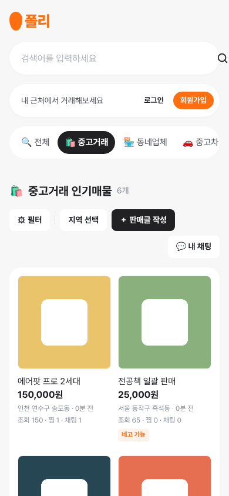

*그림 11. 390px 폭의 상품 목록 화면. 로고·검색창·상단 박스·본문이 1열로 쌓이고 상품 카드는 2열로 바뀐다. 카테고리 탭(`.tabs`)은 `overflow-x: auto`로 가로 스크롤된다.*

### 6.4 디자인 토큰과 재사용 클래스

`:root`(`style.css` 18~46행)에 색상·모서리·그림자·레이아웃 치수를 CSS 사용자 정의 속성으로 모았다.

| 분류 | 토큰 (값) |
|---|---|
| 브랜드 | `--color-primary` (`#ff6f0f`), `--color-primary-dark` (`#e85d00`), `--color-primary-light` (`#fff2e8`) |
| 텍스트 | `--color-text` (`#1a1c20`), `--color-text-sub` (`#4d5159`), `--color-text-muted` (`#868b94`) |
| 면·선 | `--color-bg` (`#f7f7f8`), `--color-surface` (`#ffffff`), `--color-border` (`#eaebee`), `--color-chip` (`#f2f3f6`), `--color-dark` (`#212124`) |
| 상태 | `--color-danger` (`#e5484d`) |
| 모서리·그림자 | `--radius-sm/md/lg/pill` (8/16/20/999px), `--shadow-soft` |
| 레이아웃 | `--col-logo` 76px, `--col-main` 600px, `--col-side` 316px, `--gap` 20px |

주요 재사용 클래스는 버튼(`.btn`과 `-primary`/`-dark`/`-gray`/`-danger`, `-sm`/`-lg`/`-block`/`-round` 변형), 칩·배지(`.chip`, `.badge-primary`), 카드(`.card`, `.card-flush`), 목록(`.product-grid`, `.rank-list`, `.list-item`, `.empty`), 폼(`.form-card(.narrow)`, `.form-error`, `.alert`, `.form-actions`), 상세(`.detail-img`, sticky `.price-box`), 채팅(`.chat-wrap`, `.chat-msg(.mine)`, `.chat-bubble`, `.chat-input-bar`)이다. `.form` 하위의 태그 선택자 규칙이 `input`, `select`, `textarea` 스타일을 일괄 지정하므로 `{{ form.as_p }}` 출력도 같은 디자인으로 표시된다.

### 6.5 페이지별 화면

**메인 (`main.html`)**: 본문에는 4열 2행 카테고리 타일 8개와 "🔥 지금 뜨는 중고거래" 순위 목록(순위, 제목, 지역·경과 시간, 가격, 조회·찜·채팅 수, 썸네일)이 있다. 타일 중 중고거래·판매하기·채팅만 실제 URL로 연결되고 나머지 5개는 `href="#"`이다. 사이드에는 지도 자리(`.map-box`)와 로그인 상태에 따라 내용이 바뀌는 "🥕 나의 폴리" 카드가 있다.

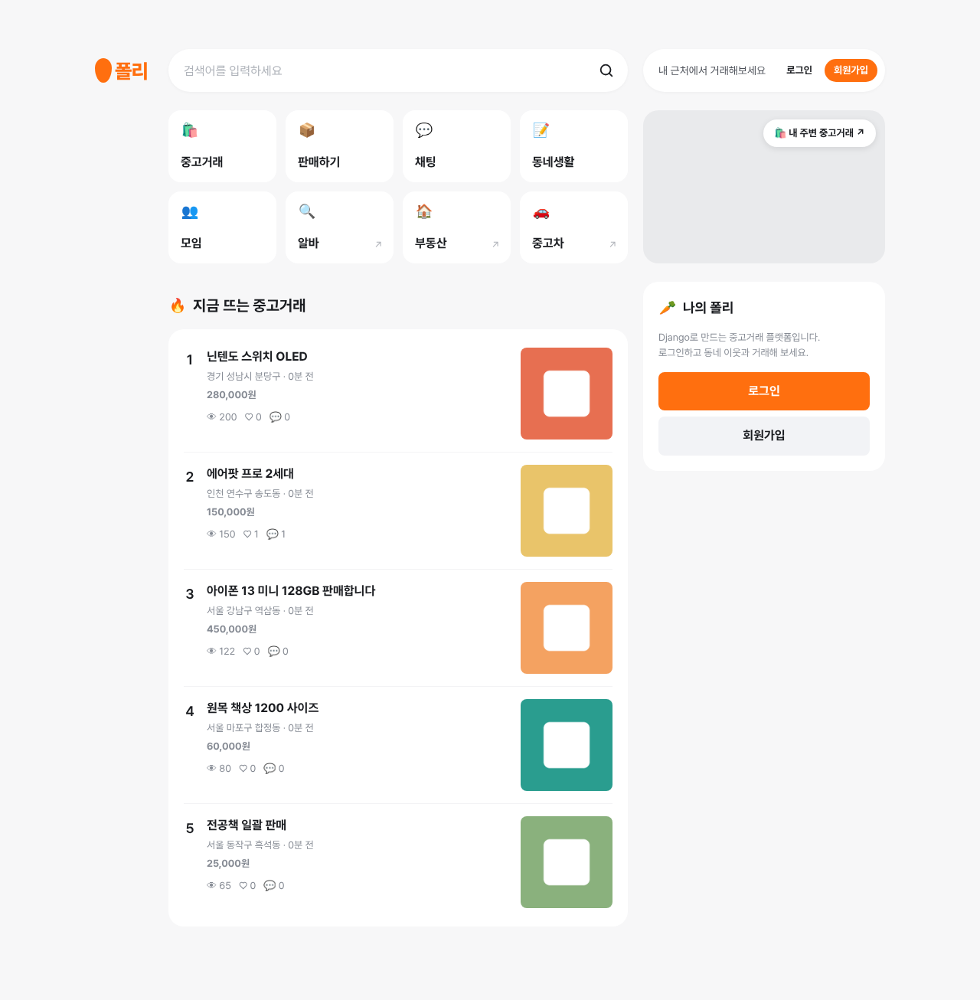

*그림 1. 메인 화면(비로그인). 로고, 본문(카테고리 타일과 인기 상품 순위), 사이드(지도 박스와 "나의 폴리" 카드)의 3단 그리드이다.*

**상품 목록 (`product_list.html`)**: 알약형 탭 바, 섹션 제목(검색 시 `"{{ query }}" 중고거래 검색 결과`, 아니면 "중고거래 인기매물"이며, 두 경우 모두 뒤에 개수(`{{ products|length }}개`)가 붙음), 툴바([필터], [지역 선택], [＋ 판매글 작성], [💬 내 채팅]), 3열 상품 카드 그리드로 구성된다. 네고 가능 상품에는 "네고 가능" 배지가 붙고, 사이드에는 인기 검색어 칩 10개가 있다.

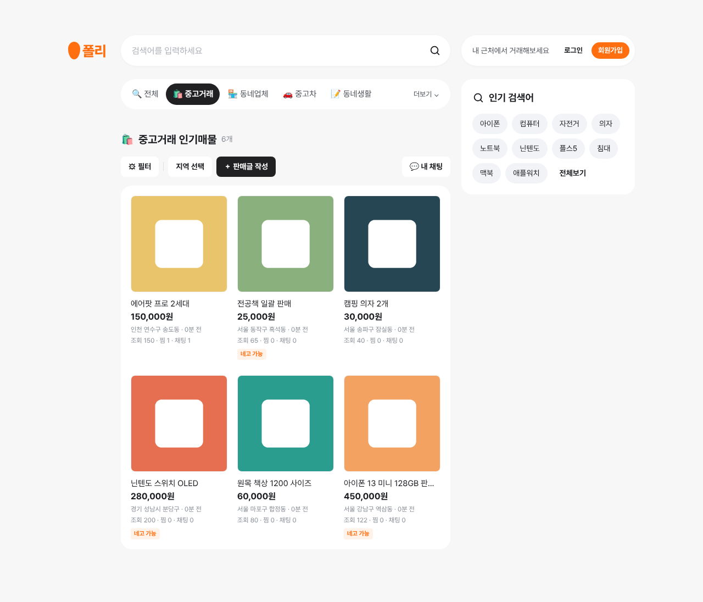

*그림 2. 상품 목록 화면. 본문에 탭 바·툴바·상품 카드 그리드, 사이드에 인기 검색어 칩이 있다.*

**상품 상세 (`product_detail.html`)**: 본문 카드에 4:3 이미지, 판매자 프로필, 제목, 경과 시간, 본문, 조회·찜·채팅 통계를 배치한다. 사이드의 sticky 가격 박스는 사용자 상태에 따라 ① 비로그인: 로그인 안내, ② 로그인한 비판매자: [판매자와 채팅하기]와 [찜하기/찜 취소], ③ 판매자 본인: "내가 작성한 게시글입니다."와 [수정하기]·[삭제하기]로 나뉜다.

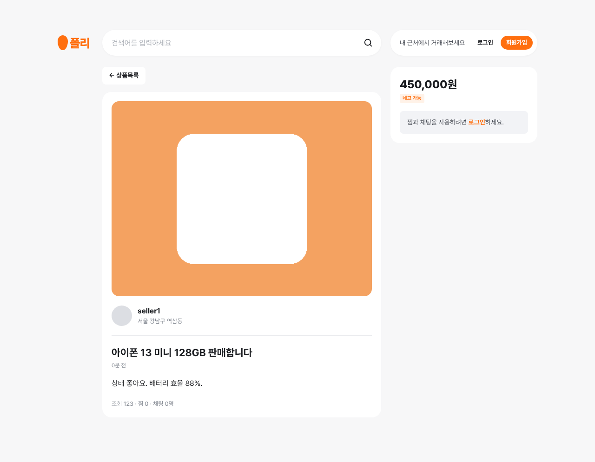

*그림 3. 상품 상세 화면(비로그인). 가격 박스에 로그인 안내 문구가 표시된다.*

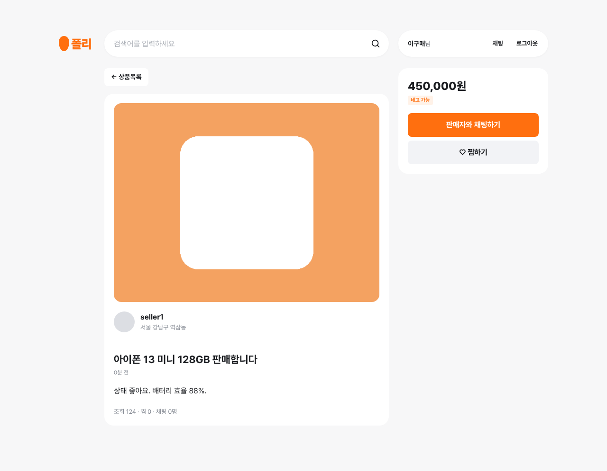

*그림 6. 상품 상세 화면(구매자로 로그인). 헤더 상단 박스가 "이구매님 / 채팅 / 로그아웃"으로 바뀌고, 가격 박스에 [판매자와 채팅하기]와 [찜하기] 버튼이 나타난다.*

**로그인·회원가입 (`login.html`, `signup.html`)**: 두 화면 모두 사이드 없이 `.form-card.narrow`(최대 440px)를 본문 열 가운데에 둔다. 로그인 화면은 `messages`를 `.alert`로 표시하고, 회원가입 화면은 6개 필드를 하나씩 출력하며 필드별 오류를 붙인다.

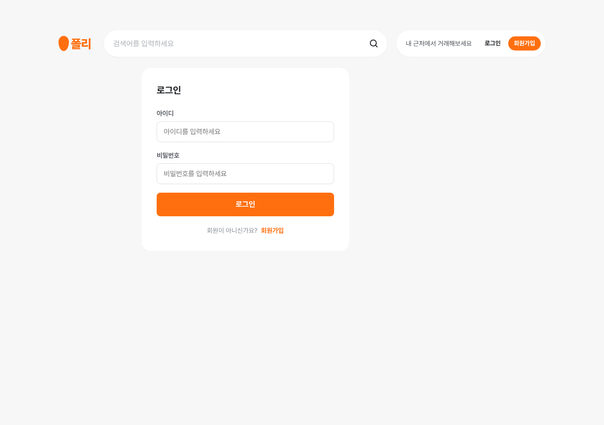

*그림 4. 로그인 화면. 좁은 폼 카드가 본문 열 가운데에 놓인다.*

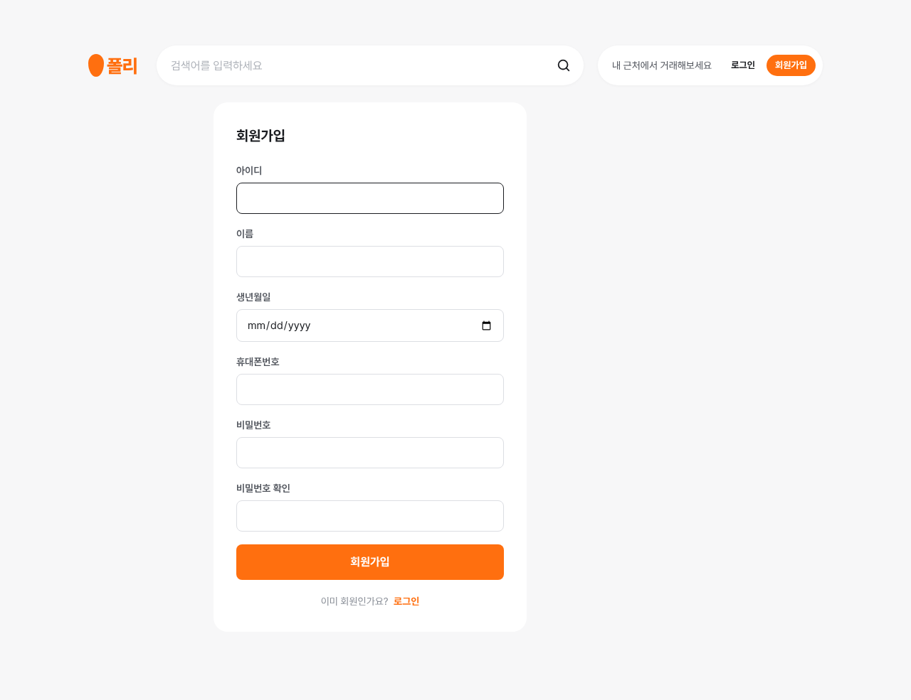

*그림 5. 회원가입 화면. 6개 입력 항목과 주황색 [회원가입] 버튼이 있다.*

**채팅 목록 (`chat_list.html`)**: `.card.card-flush` 하나에 채팅방을 `.list-item` 행(아바타 자리, 상대방 아이디와 역할 배지, 상품 제목, 48px 썸네일)으로 나열한다. 방이 없으면 "아직 채팅방이 없습니다."와 [상품 둘러보기] 버튼을 보여 준다.

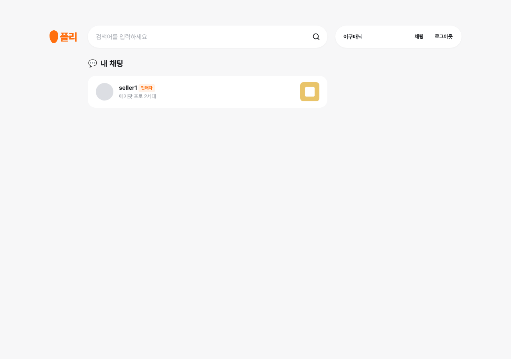

*그림 7. 채팅 목록 화면(구매자 로그인). 상대방 "seller1"에 "판매자" 배지가 붙어 있다.*

**채팅방 (`chat_room.html`)**: `.chat-wrap`이 헤더(뒤로가기, 상품 썸네일·제목, 판매자·구매자 이름, [상품 보기]), 메시지 로그, 입력바의 세 영역으로 나뉜다. 내 메시지는 오른쪽 주황 말풍선, 상대 메시지는 왼쪽 회색 말풍선과 이름으로 표시된다.

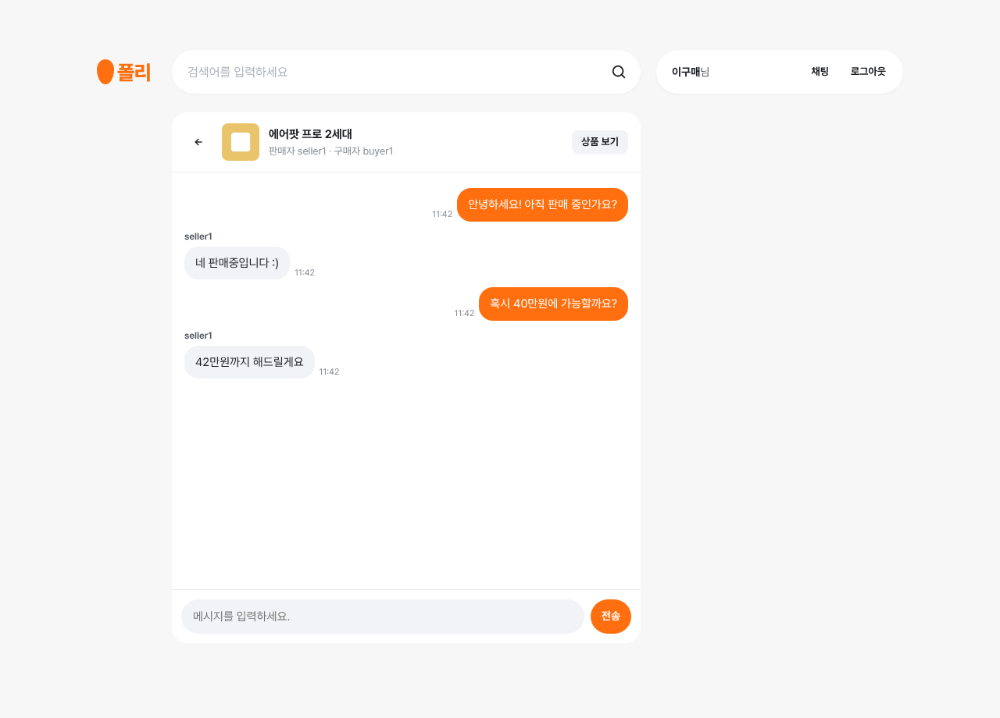

*그림 8. 채팅방 화면. 내 메시지는 오른쪽 주황 말풍선, 상대(seller1)의 메시지는 왼쪽 회색 말풍선으로 표시된다.*

**상품 등록·수정 (`product_form.html`)과 삭제 확인 (`product_delete.html`)**: 등록·수정 화면은 본문 열 전체 폭의 `.form-card`에 `enctype="multipart/form-data"` 폼과 `{{ form.as_p }}`를 두고, 하단에 [목록으로]·[저장]을 같은 너비로 배치한다. 삭제 확인 화면은 `"{{ product.title }}" 상품을 정말 삭제하시겠습니까?` 문구와 [취소]·[삭제](`btn-danger`) 버튼으로 구성된다.

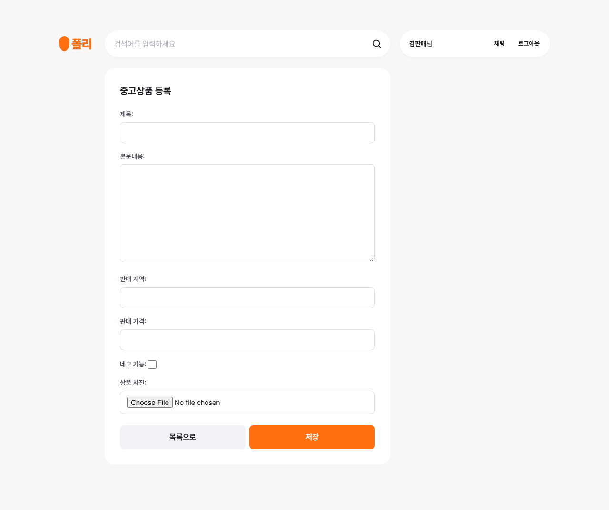

*그림 9. 상품 등록 화면. `{{ form.as_p }}` 출력에도 `.form` 공통 입력 스타일이 적용된다.*

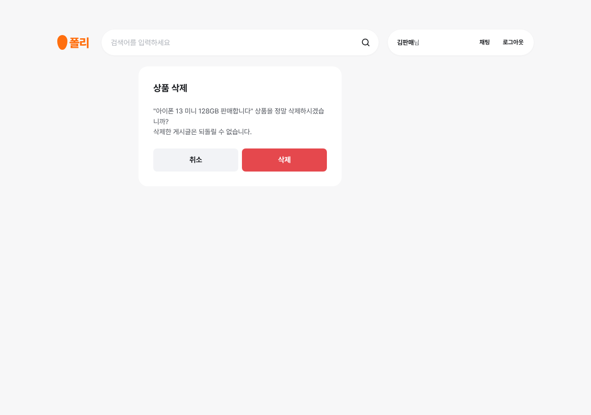

*그림 10. 상품 삭제 확인 화면. 되돌릴 수 없는 동작이므로 빨간색 `btn-danger` 버튼으로 강조했다.*

공통 헤더 include, `display: contents`, `.site` 3단 그리드 덕분에 9개 화면이 같은 틀(로고 / 본문 / 사이드)을 공유하며, 사이드가 필요 없는 화면은 `<aside>`를 생략한다. 한편 `<!-- 사진! ... -->` 주석으로 남은 이미지 자리(로고, 지도, 아바타, 아이콘), `href="#"` 링크(일부 타일·탭, 필터, 지역 선택), 정의만 되고 쓰이지 않는 `.main-wide` 클래스(`style.css` 112~114행)는 아직 정리되지 않은 자리 표시자이다.

---

## 7. 배포

### 7.1 Render 빌드 스크립트 (`build.sh`)

```bash
#!/usr/bin/env bash
set -o errexit

pip install -r requirements.txt
python manage.py collectstatic --no-input
python manage.py migrate

# python -m gunicorn config.asgi:application -k uvicorn.workers.UvicornWorker
```

`set -o errexit`로 한 단계라도 실패하면 빌드가 중단되며, **패키지 설치 → 정적 파일 수집 → DB 마이그레이션** 순으로 실행된다. 마지막 줄은 Gunicorn에 Uvicorn 워커를 붙여 ASGI 앱을 실행하는 시작 명령 예시로, 주석 처리되어 있다. 실제 Start Command는 Render 대시보드에서 설정하는 값이라 저장소에 없으며, `Procfile`이나 `render.yaml`도 없다. 이 스크립트는 처음에 `config/build.sh`로 추가되었다가(`4ed4f7c`) 루트로 옮겨졌다(`b204548`, `c22e13e`).

### 7.2 호스트 및 보안 설정

```python
DEBUG = False

ALLOWED_HOSTS = ["127.0.0.1", "localhost", "django-danggeun-market-vwl5.onrender.com"]

render_host = os.getenv("RENDER_EXTERNAL_HOSTNAME")
if render_host:
    ALLOWED_HOSTS.append(render_host)
```

`startproject` 직후에는 `ALLOWED_HOSTS = []`, `DEBUG = True`였고 `e4919a2`에서 `ALLOWED_HOSTS = ['*']`로 바뀌었으나 `4ed4f7c`에서 로컬 호스트와 `RENDER_EXTERNAL_HOSTNAME` 방식으로 바뀌었고, 마지막 커밋 `ee841ef`에서 Render 도메인을 명시적으로 추가하고 `DEBUG`를 `False`로 바꾸었다. WebSocket 라우터의 `AllowedHostsOriginValidator`도 이 목록으로 Origin을 검사한다.

### 7.3 DB, 정적 파일, 헬스 체크

- **DB**: `ENGINE = django.db.backends.postgresql`, 접속 정보는 `DB_*` 환경 변수, `OPTIONS`에 `"sslmode": "require"`와 `"connect_timeout": 10`을 지정해 Supabase에 SSL로 접속한다(`config/settings.py` 93~106행).
- **정적 파일**: `WhiteNoiseMiddleware`(65행), `STATIC_URL = "/static/"`, `STATIC_ROOT = BASE_DIR / "staticfiles"`(153~154행)로 설정했다. 빌드 시 `collectstatic`이 `staticfiles/`에 파일을 모으고 WhiteNoise가 `/static/`을 제공한다.
- **헬스 체크**: 배포 작업과 함께 `/state/` 경로를 추가했다(`market/urls.py` 14~18행). `state` 뷰는 `"server OK"`를 `text/plain`으로 반환한다.

---

## 8. 한계점 및 기말 개선 계획

중간 버전은 회원가입·로그인, 상품 CRUD, 찜, 1:1 실시간 채팅까지 핵심 흐름을 갖췄다. 그러나 HEAD 코드를 점검한 결과 다음과 같은 한계와 버그가 확인되었다.

### 8.1 기능 버그 및 동작상 한계

| # | 한계점 | 근거 | 영향 |
|---|---|---|---|
| 1 | `LOGIN_URL` 미설정 | `config/settings.py`에 `LOGIN_URL`이 없고, 실제 로그인 경로는 `/login/`이다. | 비로그인 사용자가 `@login_required` 뷰 7개에 접근하면 Django 기본값 `/accounts/login/?next=...`로 이동하는데, 이 경로가 없어 **404가 발생한다**. |
| 2 | Pillow 누락 | `market/forms.py` 106행 `forms.ImageField`, `requirements.txt`에 Pillow 없음 | `ImageField`는 검증 시 `PIL`을 import하므로, `requirements.txt`만 설치하는 배포 환경에서 사진 첨부 등록·수정 시 ImportError가 날 수 있다. |
| 3 | 상품당 이미지 1장 | `image_url`이 단일 `URLField`(`models.py` 40행) | 여러 장 업로드, 대표 이미지 지정이 불가능하다. |
| 4 | 카테고리·거래상태 없음 | `Product`에 `category`, `status` 필드가 없다. `product_list.html` 22~46행의 탭 일부, 필터(69행)·지역 선택(75행), 메인 타일 5개가 `href="#"`이다. | 카테고리 분류, 판매중/예약중/거래완료 표시, 필터링이 불가능하다. |
| 5 | 채팅 목록 정렬 | `views.py` 444행 `.order_by("-created_at")`는 방 생성 시각 기준 | 최근 대화가 오간 방이 위로 오지 않으며, 마지막 메시지 미리보기도 없다. |
| 6 | 읽음 표시 없음 | `ChatMessage`에 읽음 관련 필드가 없다. | 안 읽은 메시지 수, 새 메시지 알림을 구현할 수 없다. |
| 7 | WebSocket 재연결 없음 | `chat_room.html`에 `onclose`/`onerror` 핸들러가 없다. | 연결이 끊겨도 사용자에게 알리지 않고 재접속하지 않는다. |
| 8 | Storage 이미지 미정리 | `storage.py`에 삭제 함수가 없고, 수정은 URL만 덮어쓰며 삭제는 DB 행만 지운다. | 수정·삭제 후에도 이전 이미지가 버킷에 남는다. |

### 8.2 구조·코드 품질

- **테스트 없음**: `market/tests.py`는 `TestCase` import와 주석 한 줄뿐인 기본 파일이다.
- **로직 집중**: 인증·상품·찜·채팅·업로드 호출이 모두 `market/views.py`(491행)의 함수형 뷰에 있고, 서비스 레이어 없이 단일 앱에 들어 있다.
- **N+1 쿼리와 페이지네이션 부재**: `wish_count`/`chat_count`가 호출마다 `COUNT` 쿼리를 실행하는데, `main.html` 126~127행과 `product_list.html` 131·133행이 상품마다 이를 호출해 상품 수 × 2번의 추가 쿼리가 발생한다. `annotate(Count(...))`나 페이지네이션은 없다.
- **Storage 클라이언트의 import 시점 생성과 검증 부재**: `storage.py` 12~15행이 모듈 최상단에서 `create_client()`를 호출하므로 환경 변수가 잘못되면 `views.py` import 시점에 실패할 수 있다. `upload()` 예외 처리, 파일 형식·크기 검증도 없다.
- **공통 base 템플릿 없음**: 페이지 템플릿 9개가 `<!DOCTYPE html>`, `<head>`, CSS 링크를 각자 반복하며 ``를 쓰지 않는다.
- **소소한 정리 대상**: `config/asgi.py`의 `get_asgi_application()` 중복 호출, `market/admin.py` 25~30행에서 `ProfileAdmin` 클래스 본문 안에 남은 중복 `from .models import (...)` 구문.

### 8.3 설정·배포

- **`DEBUG = False` 하드코딩**(`config/settings.py` 28행): 환경별 전환이 불가능하며 로컬에서도 traceback이 보이지 않는다. `SECRET_KEY`는 환경 변수에서 읽지만 기본값이 없다.
- **`InMemoryChannelLayer`**: 프로세스나 인스턴스가 여러 개가 되면 서로 다른 프로세스에 붙은 사용자끼리 메시지가 전달되지 않는다. 운영 환경에는 Redis 등 외부 채널 레이어가 필요하다.
- **WhiteNoise 위치**: `MIDDLEWARE` 맨 끝(65행)에 있으나, WhiteNoise 문서는 `SecurityMiddleware` 바로 다음을 권장한다. 압축/매니페스트 스토리지(`STORAGES`) 설정도 없다.
- **의존성 파일 정리**: `requirements.txt`의 UTF-16 LE 인코딩, `psycopg`/`psycopg2`·`dotenv`/`python-dotenv` 중복, Pillow 누락, 동일 내용의 오타 파일 `requirments.txt`.
- **`staticfiles/` 커밋**: 127개 파일이 모두 `staticfiles/admin/` 아래에 있고 `market/css/style.css`는 없어 결과물로서도 불완전하다. `build.sh`가 매번 `collectstatic`을 실행하므로 `.gitignore`에 등록하는 것이 맞다(`.gitignore` 22행의 `Thunbs.db` 오타도 함께 수정).
- **문서 불일치**: `PROGRESS.md`에 "현재 `models.py`는 비어 있음"이라고 적혀 있으나 실제로는 모델 5개가 구현되어 있다. `README.md`의 `requirements.txt` 관련 안내와 `.env` 예시(`SECRET_KEY` 누락)도 현재 상태와 다르다.

### 8.4 기말 개선 계획

1. **앱 분리 및 서비스 레이어 도입**
   - 단일 `market` 앱을 `accounts`(회원·프로필), `products`(상품·찜), `chat`(채팅)으로 나눈다.
   - 비즈니스 로직을 `services.py`로 옮기고 뷰는 요청·응답 처리만 맡도록 한다.
   - 위의 설정 문제(`LOGIN_URL`, `DEBUG` 환경 변수화, asgi 중복 호출, requirements 정리와 Pillow 추가)를 함께 정리하고 테스트 코드를 작성한다.
2. **디자인 전면 개편 (Tailwind CSS + HTMX)**
   - `base.html`을 만들고 모든 페이지가 ``하는 구조로 바꾼다.
   - Tailwind CSS로 디자인을 다시 만들고, HTMX로 찜 토글·검색·목록 무한 스크롤 등 부분 갱신을 구현한다.
3. **기본 기능 확장**
   - 동네 설정(지역 선택을 실제 필터로 연결), 카테고리 분류·필터, 거래상태(판매중/예약중/거래완료) 관리
   - 다중 이미지(별도 이미지 모델, 순서 지정), 거래 후기 및 매너 평가, 알림(새 채팅, 찜한 상품 가격 변동), 신고 및 차단
   - 판매자 프로필 페이지, 최근 본 상품
   - 채팅 개선: 읽음 표시, 안 읽은 메시지 수, 마지막 메시지 순 정렬
4. **AI 기능 4종 (Gemini API 연동)**
   1. 상품 설명 자동 생성: 제목과 키워드로 판매글 본문 초안 생성
   2. 사진 인식: 업로드한 사진을 분석해 카테고리·제목 추천
   3. 사기 의심 글 탐지: 외부 메신저 유도, 선입금 요구 등 위험 패턴 경고
   4. 가격 협상 답장 초안: 채팅방의 가격 제안 메시지에 대한 답장 초안 생성

---

## 9. 결론

중간 단계에서 폴리마켓은 Django 5.2의 MTV 구조 위에 Django Channels를 결합해, 중고거래의 핵심 흐름인 회원가입·로그인, 상품 등록·검색·수정·삭제, 찜, 판매자와의 1:1 실시간 채팅을 하나의 ASGI 애플리케이션으로 구현했다. 데이터는 Supabase PostgreSQL에, 상품 이미지는 Supabase Storage에 분리해 저장했고, Render에 배포해 외부에서 접근 가능한 상태까지 도달했다.

구현 과정에서 `F()` 표현식을 이용한 원자적 조회수 증가, `get_or_create()`와 `UniqueConstraint`를 결합한 찜·채팅방 중복 방지, HTTP 뷰와 WebSocket 연결 양쪽의 권한 검사, `textContent`를 통한 XSS 방지 등 Django와 웹 개발의 기본 원칙을 코드에 반영했다. 화면은 공용 스타일시트와 디자인 토큰, 3단 반응형 그리드로 10개 템플릿이 일관된 디자인을 공유하도록 구성했다.

반면 `LOGIN_URL` 미설정으로 인한 404, Pillow 누락, `DEBUG` 하드코딩, 단일 프로세스 전용 채널 레이어, 테스트 부재, 뷰에 집중된 로직 등 해결해야 할 과제도 분명히 확인했다. 기말까지는 이러한 버그와 설정 문제를 우선 바로잡은 뒤, 앱 분리와 서비스 레이어 도입으로 구조를 정비하고, Tailwind CSS·HTMX 기반 디자인 개편, 카테고리·거래상태·다중 이미지 등 기능 확장, Gemini API를 활용한 AI 기능 4종을 차례로 구현할 계획이다.
